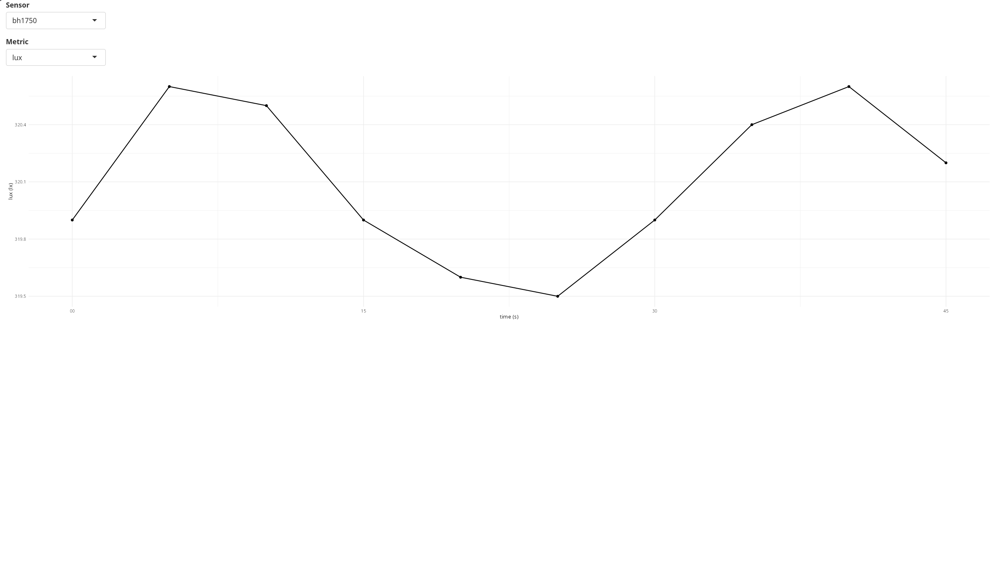
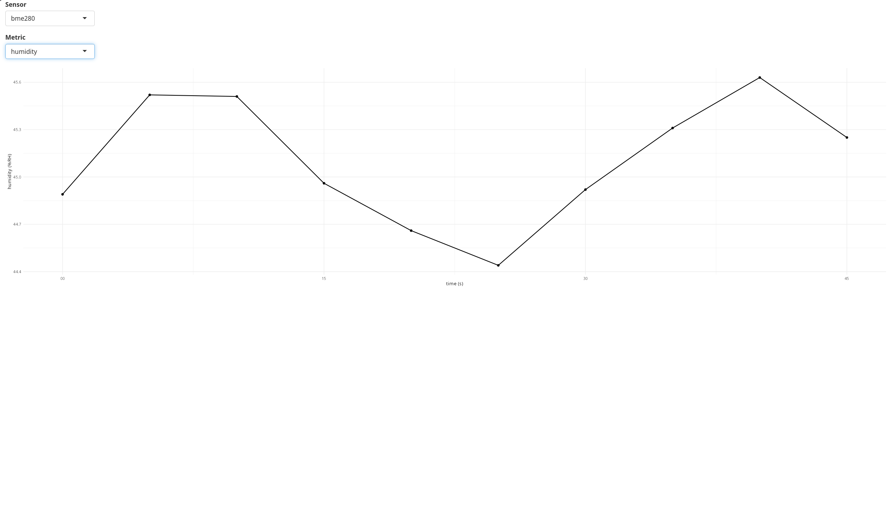
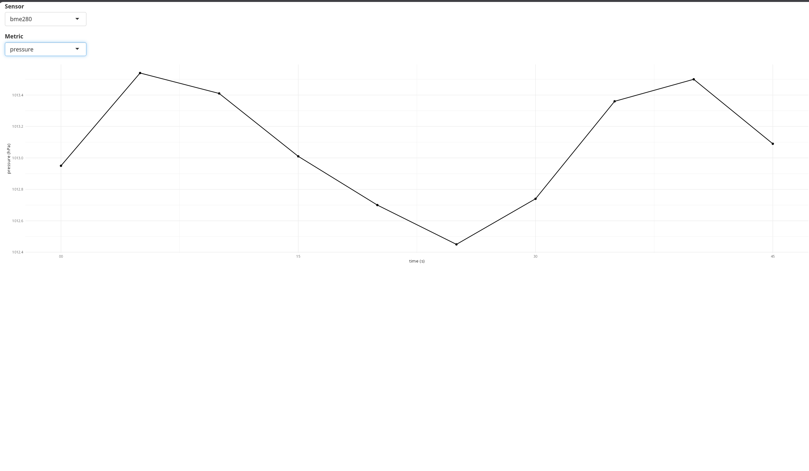
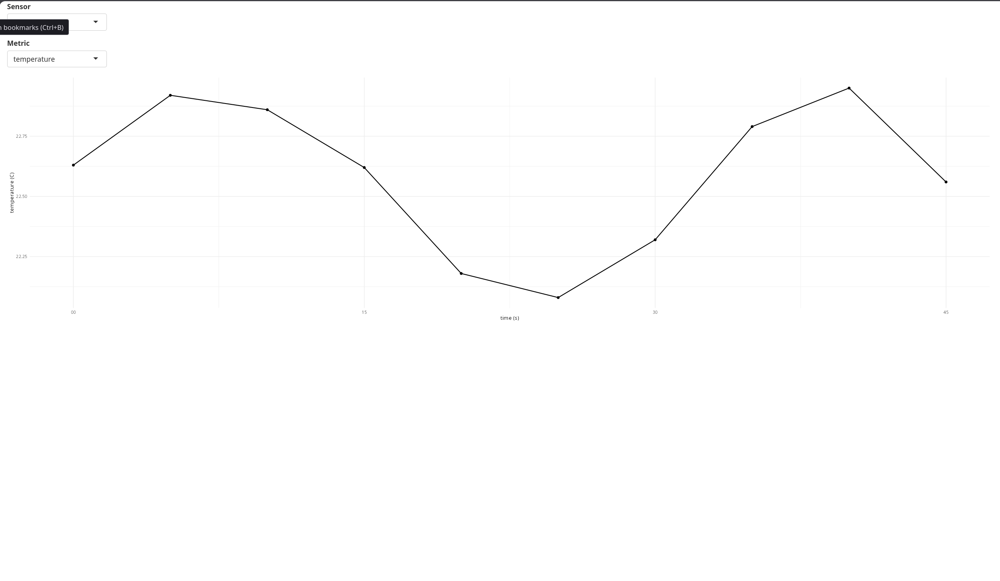
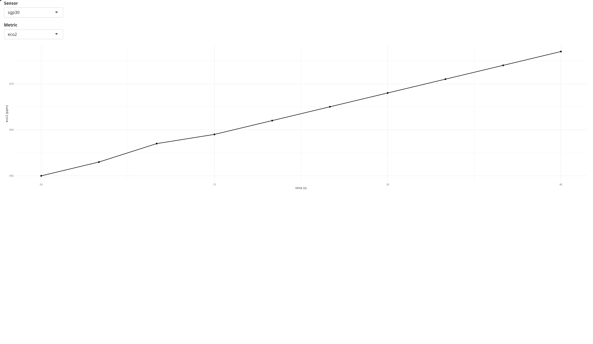
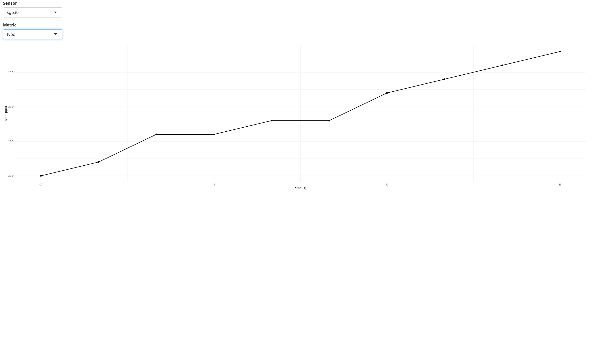

# MESS / BACKEND / R

This folder contains all the R-related backend programming regarding the analysis of data that was sent from the sensors on the ESP-32 through the web-socket. 
app.R is the driving file that utilizes the shiny library, a package that "makes it easy to build interactive web applications (apps) straight from R."  

Source (library): https://shiny.posit.co/r/getstarted/shiny-basics/lesson1/

## Explanation

app.R  

This file uses the shiny library to create a local website that provides you data read from the ESP-32 MESS. This R script expects the data to be packaged in the same predictable 
standard every reading, and expects a time range that we pull this data from. The R script is in charge of providing many graphs/models including:

- Sensor data / time
- providing graphs showing massive corelation in sensors
- Comparing two locations through every sensor available
- statistical models + values (p-values, R^2 values, linear models, causation/corelation warnings, etc...) 

## What has been implemented and whats next

Creating Selection Menu & UI
- [x] Create a selection menu for the UI
- [] Add option in menu to see all sensors at once
- [] Add option in menu to compare two different time slots / locations
- [] Add option in menu to see specialized graphs 

Graphing bme280 Multi-Sensor
- [x] Graphing each sensor in the bme280 multi-sensor over time (everything checked in mini-list?)
- [x] Graphing temperature over time
- [x] Graphing humidity over time 
- [x] Graphing pressure over time

Graphing sgp30 Multi-Sensor
- [x] Graphing each sensor in the sgp30 multi-sensor over time (everything checked in mini-list?)
- [x] Graphing eco2 (gas) over time
- [x] Graphing tvoc (Total Volatile Organic Compounds ppb) over time

Graphing bh1750 sensor
- [x] Graphing lux (light) over time

Statistical Modeling (per graph)
- [] mean 
- [] median
- [] standard deviation
- [] minimum/maximum value
- [] p95 value
- [] R^2 
- [] p-value

manipulate data using inputs:
- [] Option to clean data
- [] Option to further sort by floors
- [] Option to highlight data based on two specific floors

Specialized data comparison and analysis: 
- [] option to compare two specific time-spans / locations to an ideal environment
- [] option to compare two sensor values in a graph (i.e Lux / humidity)
- [] Box plot with all data from all places in one plot per sensor

Backend:
- [] connect backend (app.R) to front-end
- [] site boots on command in website from the front-end
- [] Integrate ability to read data directly from our SQL server (postgresql) 

Testing:
- [] Make a program that tests all use cases in this subsection
- [] Test guards for every sensor
- [] Test detection of available sensors 
- [] Test detection of missing sensors
- [] Test detection of time slot chosen

Current:
- Oyon -> postgres implementation (Adding Postgres Database to shiny)
- Alfredo -> Exporting Iframe images instead of hosting a local website 

## How it looks (example using dummy_data)
If you want to see how well that works, visit dummy_data.json inside the R folder!
<table>
  <tr>
    <td></td>
    <td></td>
  </tr>
  <tr>
    <td></td>
    <td></td>
  </tr>
  <tr>
    <td></td>
    <td></td>
  </tr>
</table>