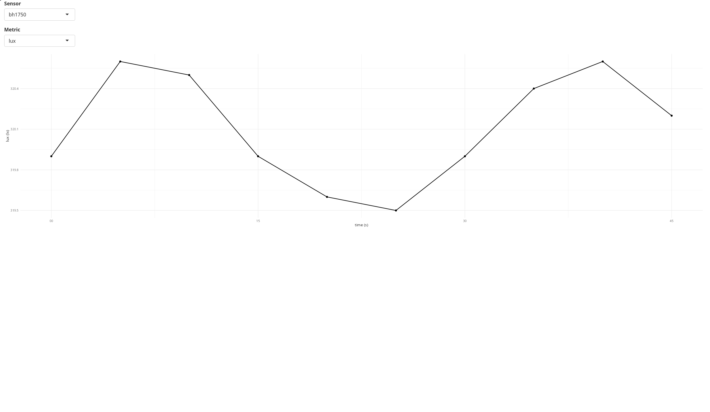
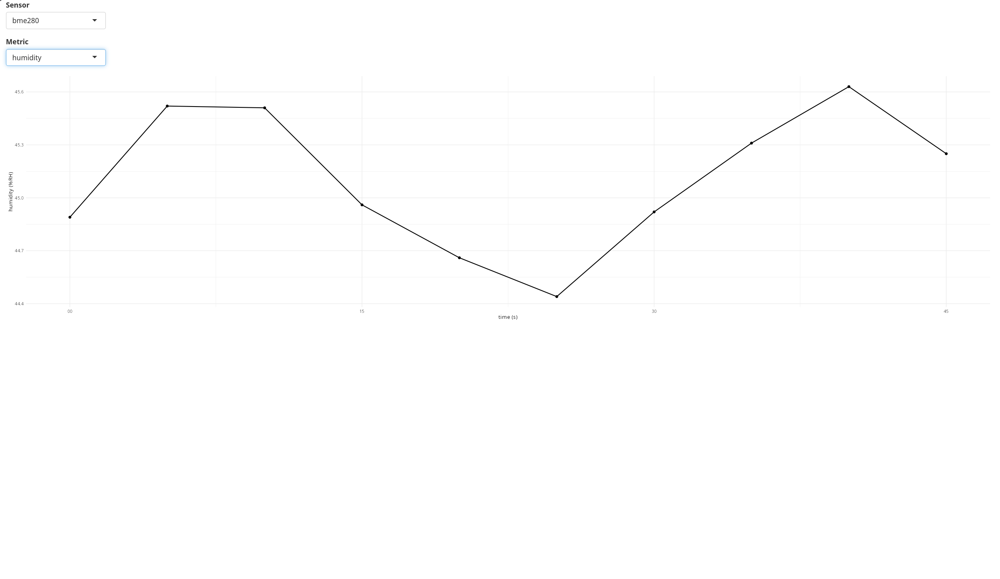
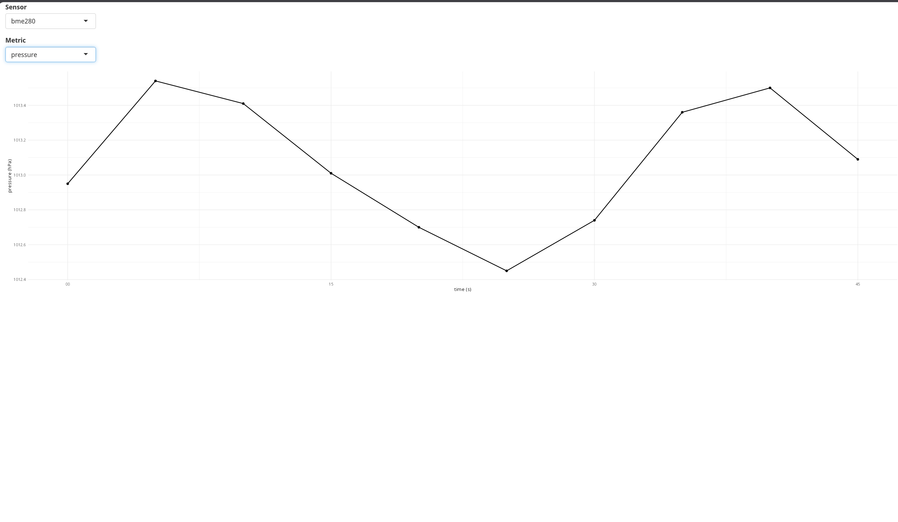
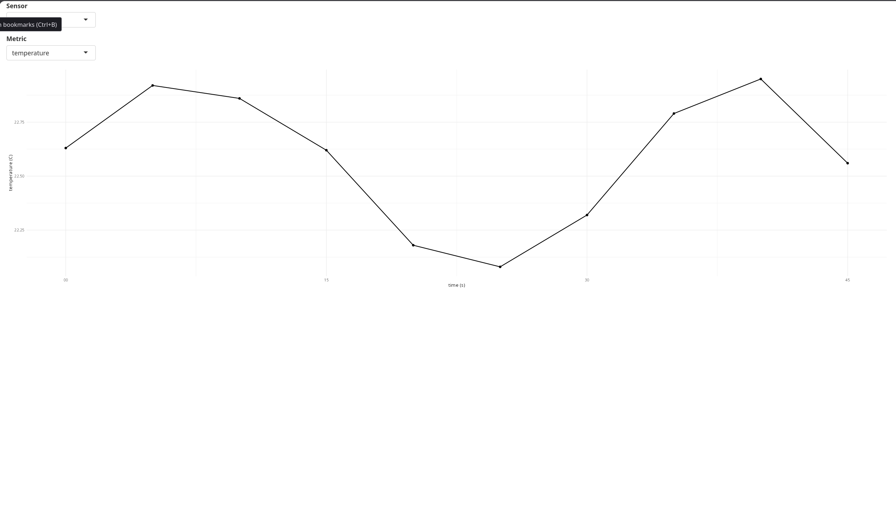
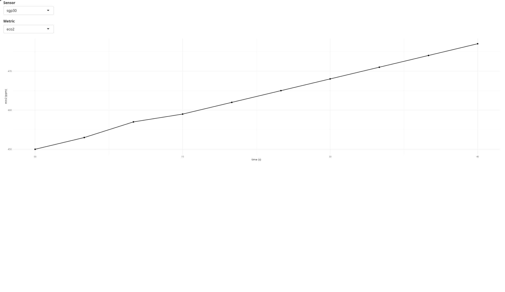
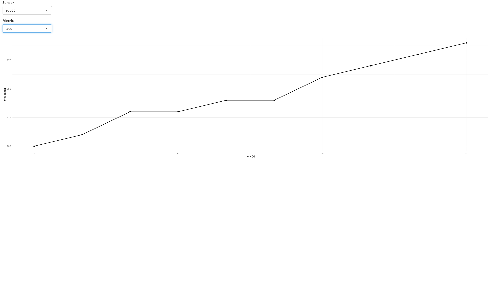

# MESS / BACKEND / R

This folder contains all the R-related backend programming regarding the analysis of data that was sent from the sensors on the ESP-32 through the web-socket. 
demoGraphingTool.R is the driving file that utilizes the shiny library, a package that "makes it easy to build interactive web applications (apps) straight from R."  

Source (library): https://shiny.posit.co/r/getstarted/shiny-basics/lesson1/

## Explanation 

demoGraphingTool.R in short will receive a JSON file from a website which has been formatted in such a way that allows the tool to manually 
create a list of sensors with their associated tables. Normally a function better for setting up the list, however I felt it was better to manually 
implement each sensor for very clear readability and simplicity. This also allows us to create troubleshooting tips more directly for expected sensors 
and to create a more refined product.  

NOTE:  
In the future I may change this to have more guards, more identification per node, statistical values per sensor (p-value, R^2 values, etc...), 
and more flexibility with nodes that don't have every sensor. Currently the R tool is running on the expectation that all 3 sensors exist! I will also
likely implement certain services for specific tables like cleaning the data, looking for causation, and showing averages across all nodes. The most significant
feature I will implement later on will be the ability to compare two locations though at least 2 or more JSON files!

## How it looks (example using dummy_data)
If you want to see how well that works, visit dummy_data.json inside the R folder!
<table>
  <tr>
    <td></td>
    <td></td>
  </tr>
  <tr>
    <td></td>
    <td></td>
  </tr>
  <tr>
    <td></td>
    <td></td>
  </tr>
</table>